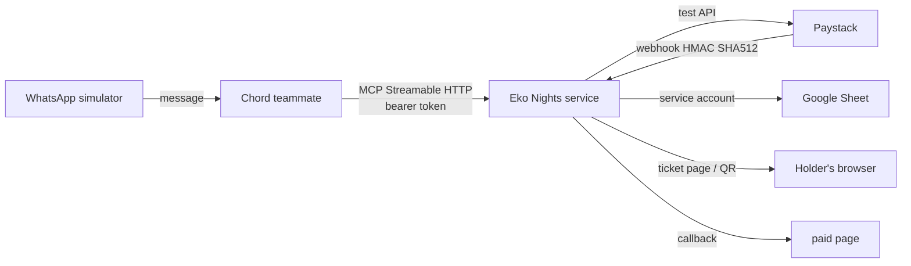

# Eko Nights tickets: a WhatsApp ticket desk on Chord

Imagine a Lagos Friday night. The lineup just dropped, the group chat is buzzing, and everyone
needs a ticket before the early-bird tier sells out. **Eko Nights** is a fictional events organiser
that turns that chaos into a calm, two-minute WhatsApp conversation. A Chord teammate answers
questions, shows live stock, takes payment through **Paystack test mode**, and issues a
single-use ticket code to every holder. Gate staff check people in with the same chat. Every
order lands in a **Google Sheet** the organiser can watch in real time.

This repo is the engine behind that teammate: a FastAPI service that exposes six MCP tools to
Chord, backed by Paystack for payments and Google Sheets for storage. All event data is made up.
Only Paystack test keys are accepted; the service refuses to start if it sees a live key.

Tickets are assigned to holders at checkout, not forwarded afterwards. Chord cannot send outbound
WhatsApp messages to arbitrary numbers, so each holder collects their ticket by messaging the
number and asking for "my tickets", or the buyer shares their ticket link with them.

## How it fits together



Chord connects custom tools as a remote MCP server, so the "custom tool" here is one FastAPI
service exposing six MCP tools:

| Tool            | What it does                                                                                         |
| --------------- | ---------------------------------------------------------------------------------------------------- |
| `list_events`   | Verified, on-sale events with tiers, prices, limits and stock (unverified events are never returned) |
| `create_order`  | Validates quantity and recipients, holds stock, creates a Paystack payment link                      |
| `check_payment` | Verifies with Paystack; on success issues one ticket per holder (idempotent)                         |
| `my_tickets`    | Tickets held by a number, so recipients can collect theirs                                           |
| `cancel_order`  | Releases an unpaid hold, checking Paystack first so a just-made payment is not lost                  |
| `check_in`      | Gate staff only (PIN): admits a code once, rejects reuse or unknown codes                            |

## Repo layout

```
app/
  service.py       business logic: holds, recipients, payment settlement, check-in
  mcp_tools.py     MCP tool definitions Chord calls
  main.py          FastAPI app: /mcp, /webhooks/paystack, /t/{code}, /paid, /health
  paystack.py      Paystack client (test mode) and an offline fake for tests
  store.py         Google Sheets backend and in-memory backend
  phone.py         Nigerian phone normalisation (0803..., +234..., 234...)
  seed.py          made-up events and tiers
skill/eko-nights-tickets/   the Chord skill (SKILL.md plus references)
scripts/           seed the sheet, register with Chord, smoke test the deployment
tests/             34 tests, including MCP calls over real HTTP
docs/
  demo-script.md            the conversation for the 3-minute recording
  buyer-test-script.md      step-by-step simulator messages for a full purchase
  gate-staff-test-script.md step-by-step simulator messages for door check-in
SUBMISSION.md      problem statement, demo link, go-live note, field notes
```

## Run it locally (no accounts needed)

```bash
python -m venv .venv && source .venv/bin/activate
pip install -r requirements-dev.txt
python -m pytest -q                      # all tests run offline

STORE_BACKEND=memory PAYSTACK_MODE=fake STAFF_PIN=1234 MCP_BEARER_TOKEN=dev \
  uvicorn app.asgi:app --reload
curl localhost:8000/health
```

`memory` and `fake` modes are for development only. The demo uses Sheets and Paystack test mode.

## Set up the real integrations

**1. Google Sheet**

1. Create a blank Google Sheet and copy its ID from the URL.
2. In Google Cloud, create a service account, enable the Google Sheets API, and download a JSON key.
3. Share the sheet with the service account's `client_email` as Editor.
4. Seed it: `GOOGLE_SHEET_ID=... GOOGLE_SERVICE_ACCOUNT_JSON=./key.json python scripts/seed_sheet.py`

This creates `events`, `tiers`, `orders` and `tickets` tabs. To mark an event unverified or pull it
from sale, change `verified` or `on_sale` in the sheet; the agent picks it up within 30 seconds.

**2. Paystack (test mode)**

1. Copy your `sk_test_` secret key from the Paystack dashboard.
2. In the test-mode webhook settings, set the webhook URL to `https://<your-service>/webhooks/paystack`.
3. Pay with the test cards in Paystack's documentation, including a failing one to exercise the failure path.

**3. Deploy**

`render.yaml` deploys to Render; the `Dockerfile` works anywhere that runs containers. Set the
variables in `.env.example`. For `GOOGLE_SERVICE_ACCOUNT_JSON` on a host, paste the key JSON
itself as the value. Then:

```bash
PUBLIC_BASE_URL=https://<your-service> MCP_BEARER_TOKEN=<token> python scripts/smoke_test.py
```

Free hosting tiers sleep when idle, so the first tool call after a quiet spell can be slow. Wake
the service before recording or demoing.

**4. Connect to Chord**

1. Create the teammate: zip the `skill/eko-nights-tickets` folder and upload it under
   **Teammates → Create a teammate**, then confirm `SKILL.md` is marked **Instructions** and publish.
2. Register the tool server, either in the app (**Teammate settings → Tools → Add tool**) with URL
   `https://<your-service>/mcp`, bearer auth and your `MCP_BEARER_TOKEN`, or with
   `scripts/register_chord_mcp.sh`.
3. Check the teammate shows the tools as **On**. Per the Chord docs, a tool must be both allowed for
   the teammate and connected in the workspace, and an empty `mcp_server_ids` means every enabled
   server in the workspace.
4. Test in the in-app conversation, then in the WhatsApp simulator.

## Design choices

- **Holders are fixed at checkout.** The buyer decides before paying, so each person gets their
  own code from the start and there is nothing to reassign afterwards.
- **Tickets are not forwarded automatically.** Chord has no API to send WhatsApp messages to
  arbitrary numbers. Holders collect tickets by messaging the number and asking for "my tickets",
  or the buyer shares their ticket link.
- **Verification before issue.** Tickets are only issued after Paystack's verify endpoint
  confirms success and the amount and currency match the order. The webhook triggers the same
  check rather than trusting its own body.
- **Holds, not optimism.** Stock is held for `HOLD_MINUTES` while the customer pays. A payment
  that arrives after the hold lapsed is honoured if stock remains, otherwise flagged
  `needs_review` for a refund instead of overselling.
- **Errors the model can act on.** Tools return `{code, message, next_step}` instead of raising,
  and the skill maps each code to what the customer should hear.
- **Privacy by default.** Check and cancel only work for the buyer's number; ticket listings mask
  phone numbers; gate check-in needs a staff PIN.

## Known limits

- **Identity comes from the model.** Tools take `buyer_phone` as an argument, so they trust the
  agent to pass the number it is chatting with. In production the number should come from the
  channel, not the model. See the field notes.
- **No proactive WhatsApp delivery.** Chord cannot send outbound WhatsApp messages to arbitrary
  numbers, so the agent cannot forward tickets. Holders must message in or receive a shared link.
- **Single instance.** Stock is protected by an in-process lock and a Google Sheet. That is fine
  for a demo, not for a big on-sale; production needs a database with transactions.
- **Out of scope by design:** organiser onboarding and verification workflow, refunds, holder
  changes after payment, resale, seating, offline check-in.

## Future improvements

- **Channel-derived identity.** When Chord exposes the sender's WhatsApp number in MCP context,
  override `buyer_phone` so the agent cannot be tricked into revealing another person's tickets.
- **Database backend.** Replace Google Sheets with PostgreSQL + row-level locking before a real
  on-sale.
- **Retry wrapper for Paystack.** Add `tenacity` retries around `initialize` and `verify` for
  transient timeouts.
- **Outbound WhatsApp templates.** If Chord later supports approved templates or a send-to-number
  API, implement proactive ticket delivery to assigned holders.
- **Refund endpoint.** Add a staff-only `refund_order` tool once the Paystack refund flow is
  defined.

## How I used AI tools

The first draft of the service, tests, skill files and docs was produced with Claude (Anthropic)
from my brief and product decisions. I then used GitHub Copilot to review the submission against
the TSG Labs rubric, deploy the service on Render, register the MCP server with Chord, debug
Windows/WSL and Git authentication issues, investigate the Chord API and WhatsApp simulator
behaviour, and refine the skill instructions and documentation. I reviewed every change manually,
ran the test suite, and tested the agent in the Chord simulator. The field notes are my own
record of what happened.
